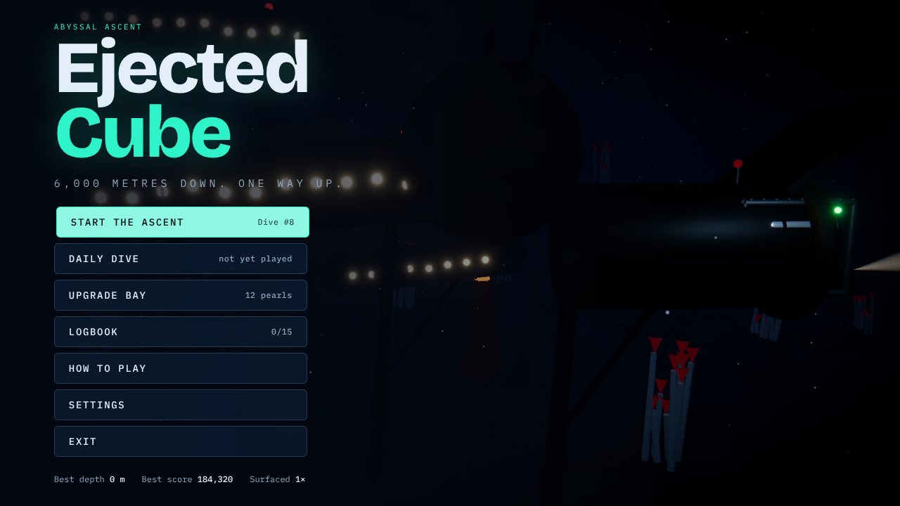
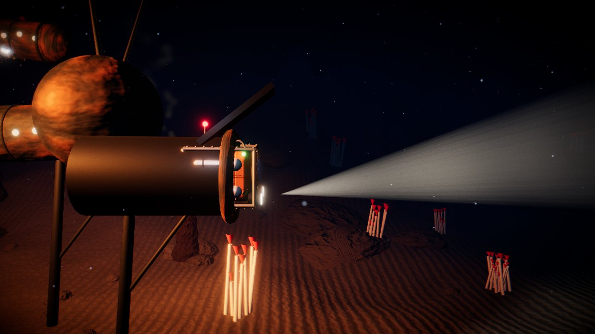
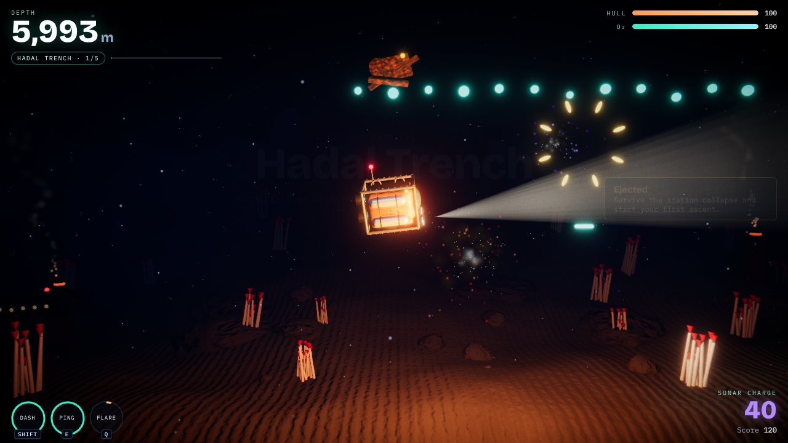
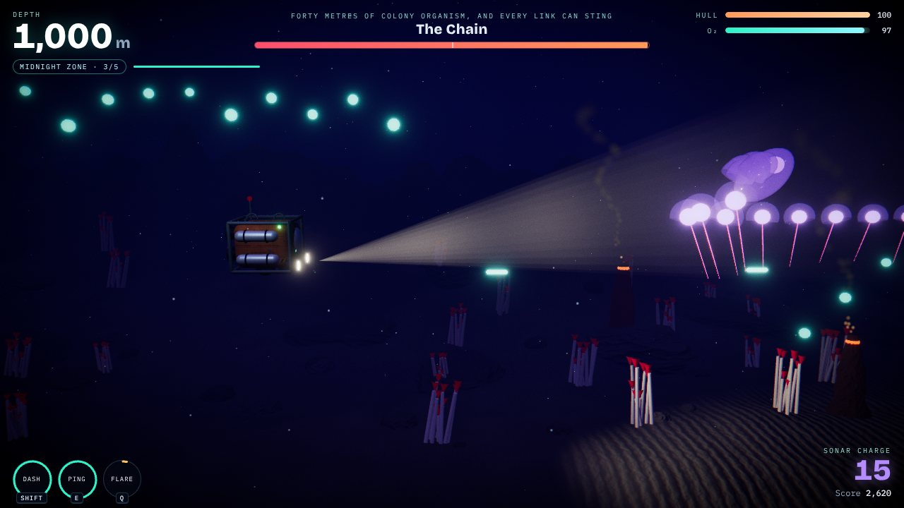
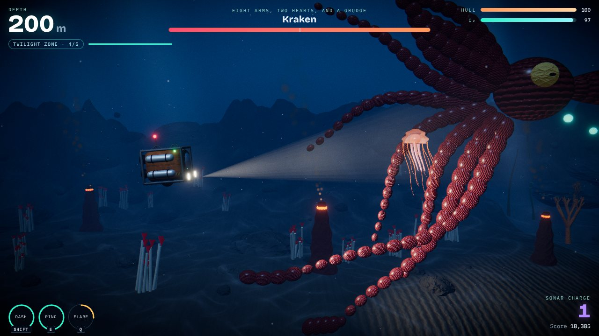
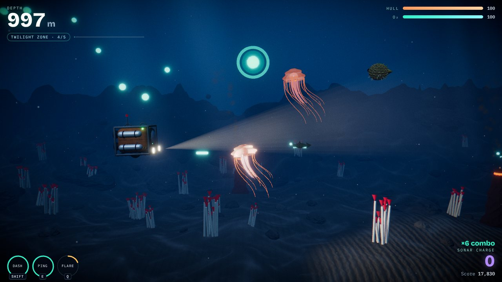
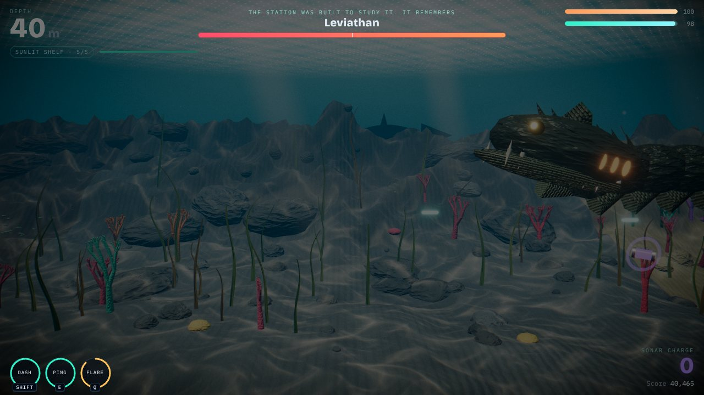

<div align="center">

# Ejected Cube: Abyssal Ascent

**A 3D underwater escape shooter for the browser, built with Three.js and TypeScript.**

Hadal Station Kestrel is collapsing six kilometres below the surface. Its last escape capsule, EC-07, fires you out into the trench. Climb through five depth zones, past five bosses, and break the surface before your oxygen runs out.



</div>

## Screenshots

| | |
|---|---|
|  |  |
|  |  |
|  |  |

## Features

### The ascent
- **Five depth zones** that change the whole world as you rise: Hadal Trench (6,000 m), Abyssal Plain, Midnight Zone, Twilight Zone and Sunlit Shelf. Each has its own fog, light, seabed palette, set dressing, ocean current, enemy mix and generative soundtrack.
- **Distance is depth.** The counter runs from 6,000 m down to 0, and reaching the surface is the ending.
- **Endless +1:** after you surface, dive again at a higher difficulty.
- **Daily dive:** a date-seeded run, identical for everyone each day.

### Survival
- **Oxygen drains all the time.** Collect glowing plankton to refill it. Chained pickups build a combo.
- **Hull** is your health. Repair crates restore it.
- **Sonar ammo** regenerates slowly, so you are never fully disarmed.
- **Darkness:** in the deep zones creatures are almost invisible outside your floodlight. A **sonar ping** reveals and stuns them, and uncovers hidden **pearls**.
- **Dash** gives brief invulnerability and rams through small creatures.
- **Bioflare:** fill the lumen meter with combos, then clear the whole screen.
- **Power-ups:** shield bubble, plankton magnet, triple sonar and homing torpedoes.

### Creatures
| Species | Behaviour |
|---|---|
| Sea urchin | Drifting spike ball, sheds spines when destroyed |
| Jellyfish | Pulse-glide swimming, shader-animated tentacles |
| Naval mine | Chained to the seabed, arms when you approach; shoot it for chain reactions |
| Lanternfish | Schools that home in on the pod |
| Pufferfish | Inflates near you, then bursts into spikes |
| Station debris | Wreckage falling from the collapsing station |

### Bosses
Every big attack is announced by a pulsing red danger lane. Each boss has a second phase below 50% HP.

| Zone | Boss | Signature attacks |
|---|---|---|
| Hadal | **Thermal Warden**, a magma-veined vent crab | Lava lobs, claw shockwave, eruption |
| Abyssal | **The Lantern**, a giant anglerfish | Blinding lure that summons lanternfish, full-screen lunge, tooth volleys |
| Midnight | **The Chain**, a siphonophore colony | Sequential volleys, whip dive, radial blooms |
| Twilight | **Kraken**, with ten animated arms | Tentacle slams, ink clouds, clubbed grabs |
| Sunlit | **Leviathan**, an armoured serpent | Screen-crossing charge, walls of orbs with one gap, summons |

### Progression
- **Upgrade bay:** spend pearls on seven upgrade tracks (hull, oxygen, damage, fire rate, dash, passive magnet, flare charge).
- **Logbook:** 15 achievements, a top-10 run history and lifetime stats.
- Progress saves to the browser automatically.

### Every screen
Loading, home, how to play, settings, upgrade bay, logbook, pause, death (a different message for each cause), victory and exit.

## Controls

| Action | Keyboard / mouse | Touch |
|---|---|---|
| Steer | Mouse, or WASD / arrow keys | Drag anywhere |
| Fire | Hold left click, or Space | Auto-fire (toggle with FIRE) |
| Sonar ping | Right click, or E | PING |
| Dash | Shift | DASH |
| Bioflare | Q | FLARE |
| Pause | Esc / P | II |

## Tech stack

| Layer | Choice | Why |
|---|---|---|
| Language | **TypeScript** (strict) | Catches whole classes of bugs before they ship |
| Build | **Vite** | Instant dev server, hashed and tree-shaken production builds |
| Rendering | **Three.js** r187 | Mature WebGL 2 engine with PBR materials |
| Post-processing | **pmndrs/postprocessing** | Bloom, chromatic aberration, vignette, grain and ACES tone mapping merged into one pass |
| Audio | **WebAudio**, fully procedural | The soundtrack and every sound effect are synthesized at runtime. No audio files |
| Art | **Procedural** | Every model, texture and terrain is generated in code. No image or model downloads |
| Fonts | **Fontsource** (self-hosted) | No third-party requests, works offline |
| Hosting | GitHub Pages / Vercel / Netlify | Static site; configs for all three are included |
| Offline | Service worker + web manifest | Installable, and plays offline after the first visit |

There are only two runtime dependencies: `three` and `postprocessing`.

## Performance

The game is built to stay at 60 FPS on mid-range laptops and phones:

- **Delta-time simulation:** the game runs at the same speed at 30, 60 or 144 Hz.
- **No allocations during play:** enemies, pickups, projectiles and bosses come from preallocated pools.
- **Instancing everywhere:** rocks, kelp, coral, plankton, fish, projectiles, boss arms and body segments are drawn as `InstancedMesh`. A typical frame is 70–120 draw calls.
- **GPU particles:** bubbles, sparks and smoke are written once into a ring buffer and animated entirely in the vertex shader. Only new particles are uploaded.
- **Constant light count:** effects reuse one pooled flash light, so shaders never recompile mid-game. Boss materials are compiled on arrival, and all others during loading.
- **One post-processing pass** for every screen effect, with bloom at reduced resolution.
- **Quality presets plus an automatic governor** that steps quality down if the frame rate drops.
- **Swept collisions:** fast shots can't tunnel through small targets at low frame rates.
- **DOM HUD with change detection:** the HUD writes to the page only when a value actually changes.
- **Recycled terrain:** three seabed tiles regenerate ahead of the camera.

## Getting started

Requires Node 20 or later (22 recommended).

```bash
npm install
npm run dev        # http://localhost:5173
```

```bash
npm run build      # type-check, then production build into dist/
npm run preview    # serve the production build locally
```

## Deploying

The build output in `dist/` is a static site that works on any host, at the domain root or in a sub-folder.

**GitHub Pages (included workflow):** push to `main`. Then, once, open repo **Settings → Pages → Source** and choose **GitHub Actions**. Every later push to `main` redeploys automatically.

**Vercel:** import the repository at vercel.com/new. `vercel.json` already sets the build command, output folder and cache headers.

**Netlify:** import the repository. `netlify.toml` already holds the settings.

**itch.io:** run `npm run build`, zip the contents of `dist/`, upload the zip as an HTML5 game and tick "This file will be played in the browser".

## Project structure

```
src/
  main.ts            entry: WebGL check, boot, service worker
  core/              renderer + post FX, loop, input, quality, pools, noise, RNG
  audio/             procedural music and sound effects
  world/             atmosphere, seabed, fauna, station, procedural textures and shader patches
  entities/          player pod, enemies, pickups
    bosses/          five bosses on a generator-scripted base class
  combat/            projectile pools
  fx/                particles, sonar ping, camera rig, flashes, danger telegraphs
  game/              Game state machine, zones, save data, upgrades and achievements
  ui/                HUD and every menu screen
  styles/            CSS
```

There is a deeper tour in [docs/ARCHITECTURE.md](docs/ARCHITECTURE.md).

## License

MIT. See [LICENSE](LICENSE).
