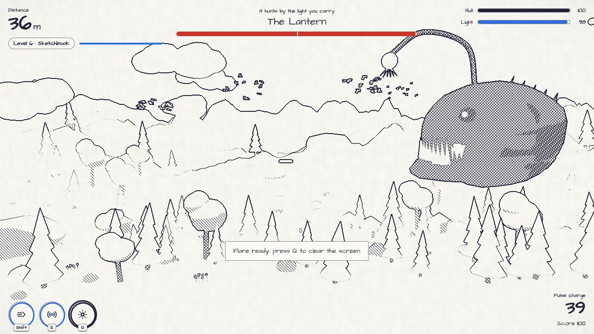

<div align="center">

# Ejected Cube

**A 3D flying shooter where every level is a different world, made with Three.js and TypeScript.**

The Atlas is a book where every page is a whole world. A drop of ink, the Blot, is eating its pages. The Atlas Engine fired its last cube of light out into the scattered pages, and you fly it home, one world at a time.


</div>

## Ten worlds, picked at random

Every run starts on a random world, and every new level turns the page to another one. The whole game re-skins each time: landscape, props, wildlife, particles, lighting, materials, post-processing, music and the interface itself.

| World | Look |
|---|---|
| **Abyssal Trench** | Deep sea: realistic lighting, kelp, vents, whale silhouette. The dark hides creatures |
| **Paper Sky** | Folded paper hills, cut-out clouds, windmills, paper grain and ink outlines |
| **Clean Room** | A white laboratory: tiled floor, pylons with signal-orange strips, lab drones |
| **Sketchbook** | Pencil line art: cross-hatching drawn by a screen-space shader |
| **Summer Sky** | Cel-shaded summer day: tall cumulus, power lines, saturated colour |
| **Brick Town** | Glossy plastic toy bricks with studs, including the ground |
| **Clay Valley** | Matte clay mushrooms and blob trees in pastel light |
| **Ink Mountains** | Sumi-e ink wash on rice paper; only vermilion keeps its colour |
| **Red Mesa** | Sunset desert, saguaro cacti, blowing sand |
| **Glacier Light** | Polar night with an animated aurora, ice crystals, snowfall |

| | |
|---|---|
|  |  |
|  |  |
|  |  |
|  |  |
|  |  |

In Settings → Worlds you can choose which worlds are in the rotation, lock the game to one favourite, or keep the interface on one look.

## The journey

- **Story:** an animated paper cut-out storybook plays on the first visit and can be replayed from the home screen. It ends by tearing in half to reveal the game.
- **Levels:** numbered levels with a boss every third level. Difficulty rises in a sawtooth curve: each level gets busier toward its gate, and the level after a boss starts a little easier. Enemy health, damage, bullet speed, scroll speed, currents and new creature types all ramp up.
- **Checkpoints:** after each boss you can start later runs from that level (Journey map).
- **Ending:** beating the fifth boss at level 15 plays the story's ending. Then the pages beyond fifteen continue with stronger bosses.
- **Difficulty:** Relaxed, Normal and Hard presets.
- **Daily run:** a date-seeded run, identical for everyone each day.

## Playing

- **Light** fades all the time; collect glowing sparks to keep it up. Chained sparks build a combo.
- **Hull** is your health; repair kits restore it.
- **Pulse** reveals hidden creatures and **shards** (the currency), and stuns some creatures.
- **Dash** gives brief invulnerability and rams through small creatures.
- **Bioflare:** fill the flare ring with combos, then clear the screen.
- **Power-ups:** shield, spark magnet, triple bolt and seekers.
- **Six creature types** and **five bosses** with telegraphed attacks and second phases.

| Action | Keyboard / mouse | Touch |
|---|---|---|
| Steer | Mouse, or WASD / arrows | Drag anywhere |
| Fire | Hold left click or Space | Automatic |
| Pulse | Right click or E | PULSE |
| Dash | Shift | DASH |
| Bioflare | Q | FLARE |
| Pause | Esc / P | Pause button |

The first run starts with a five-step **interactive tutorial** (fly, fire, dash, pulse, flare). On the first visit, a short **guided tour** points out the home screen. Both can be replayed.

## Make it yours

The **Hangar** has a live 3D preview:
- 12 hull colours, 6 accents and 7 patterns (hazard band, stripe, checker, panels, splotch, polka)
- A call sign painted on the hull
- Three hull shapes, floodlight colours, five engine trails and an optional roll cage
- Seven upgrade tracks (hull, light reserve, damage, fire rate, dash, magnet, flare charge)

Shards come from hidden pickups, bosses and **missions**. There are always three active, they carry over between runs, and they get harder each time you complete one.

The **Logbook** has 17 achievements, the worlds you've visited, your top-10 runs and lifetime stats.

## Tech stack

| Layer | Choice |
|---|---|
| Language | TypeScript (strict) |
| Build | Vite |
| Rendering | Three.js r187 (WebGL 2), PBR materials restyled per world |
| Post-processing | pmndrs/postprocessing plus a custom stylize effect (Sobel ink outlines, hatching, ink wash, paper grain) |
| Audio | WebAudio, fully procedural: no audio files |
| Art | Procedural: every model, texture, terrain and the storybook are generated in code |
| Fonts | Self-hosted with Fontsource, one display face per world |
| Offline | Service worker and installable web app manifest |

Runtime dependencies: `three` and `postprocessing` (plus font files).

## Performance

- Delta-time simulation: the same speed at any refresh rate
- Object pools for every enemy, pickup and projectile: no allocations during play
- Instanced rendering for props, wildlife, clouds, sparks, bullets and boss limbs
- GPU particles animated entirely in the vertex shader
- World swaps happen behind the page-turn transition, with shaders compiled while the screen is covered
- Constant light count, so shaders never recompile mid-fight
- Quality presets, plus an automatic governor that steps quality down when the frame rate drops
- HUD that only touches the DOM when a value changes

## Getting started

```bash
npm install
npm run dev        # http://localhost:5173
```

```bash
npm run build      # type-check + production build into dist/
npm run preview
```

Add `?debug` to the URL of a production build to expose `window.game` (for example, `game.debugTheme('ink')`).

## Deploying

`dist/` is a static site that works at a domain root or in a sub-folder.

- **GitHub Pages:** push to `main`, then once set **Settings → Pages → Source → GitHub Actions**. The included workflow builds and deploys on every push.
- **Vercel:** import the repo; `vercel.json` has the settings.
- **Netlify:** import the repo; `netlify.toml` has the settings.
- **itch.io:** zip the contents of `dist/` and upload it as an HTML5 game.

## Project structure

```
src/
  core/       renderer + post FX, loop, input, quality, pools, noise, RNG
  themes/     the ten world definitions and the material styler
  world/      atmosphere, ground + props, clouds, wildlife, textures, shader patches
  entities/   the cube (model, hull painter, flight), enemies, pickups, bosses
  combat/     projectile pools
  fx/         particles, stylize effect, pulse ring, camera rig, flashes, telegraphs
  game/       Game state machine, levels, missions, cosmetics, save data, upgrades
  ui/         HUD, every screen, storybook, page turns, icons, theme tokens
  styles/     CSS
```

There is a deeper tour in [docs/ARCHITECTURE.md](docs/ARCHITECTURE.md).

## License

MIT. See [LICENSE](LICENSE).
